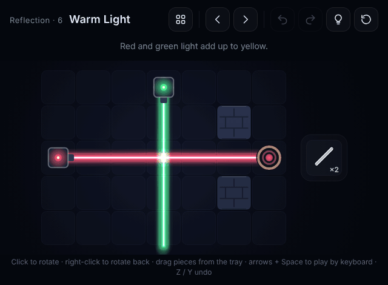
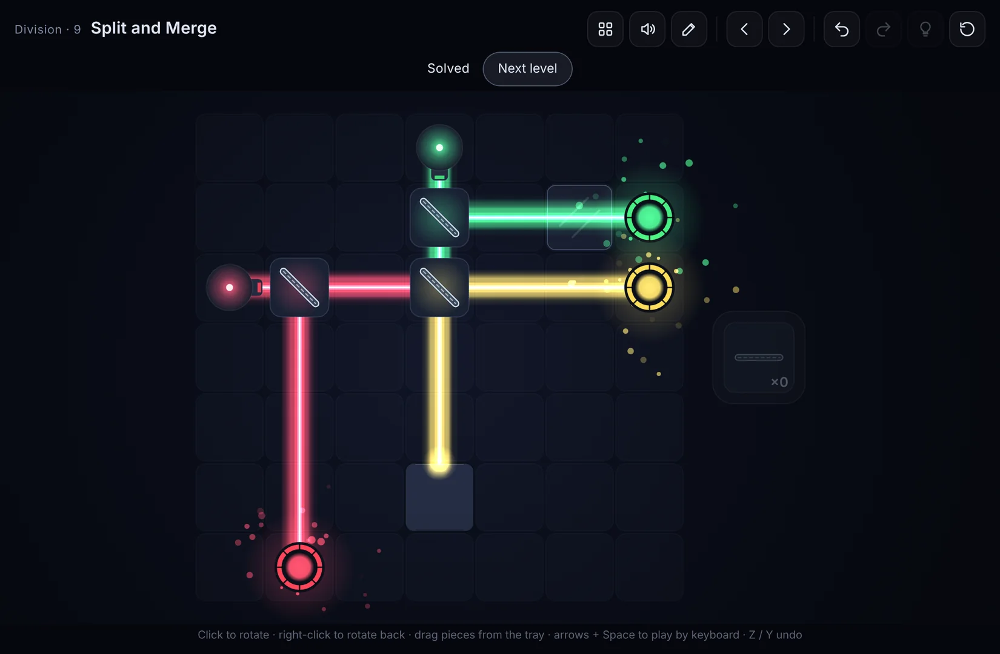
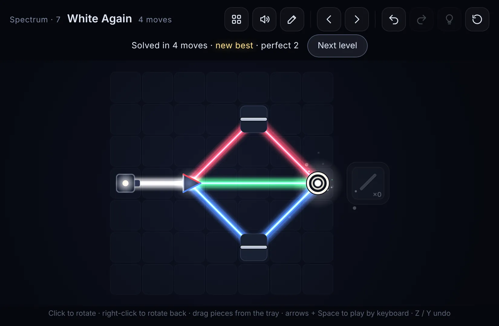
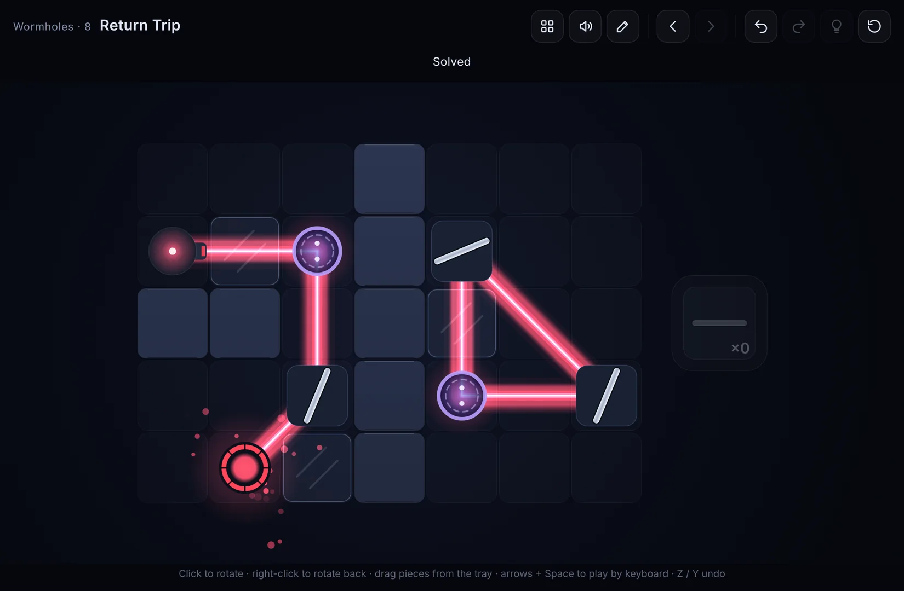
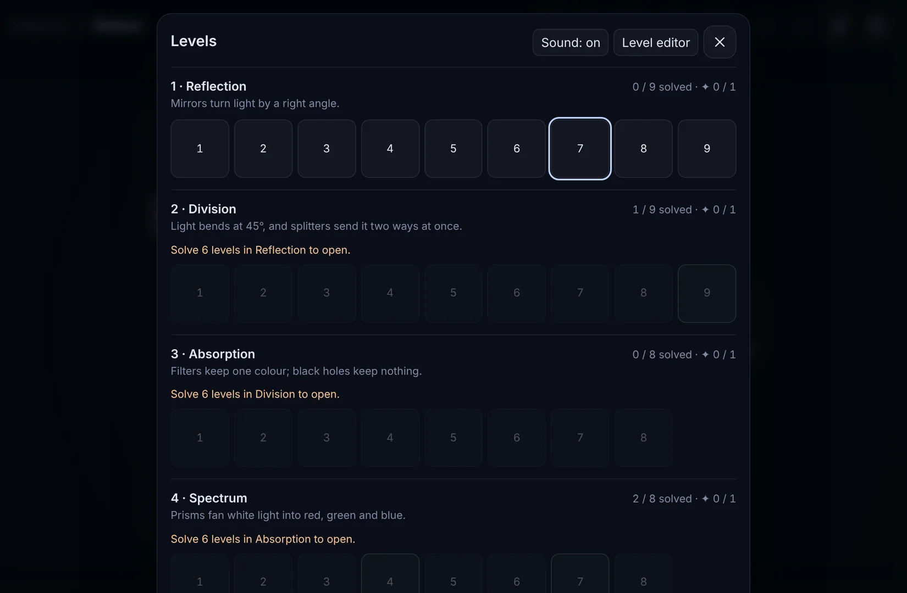
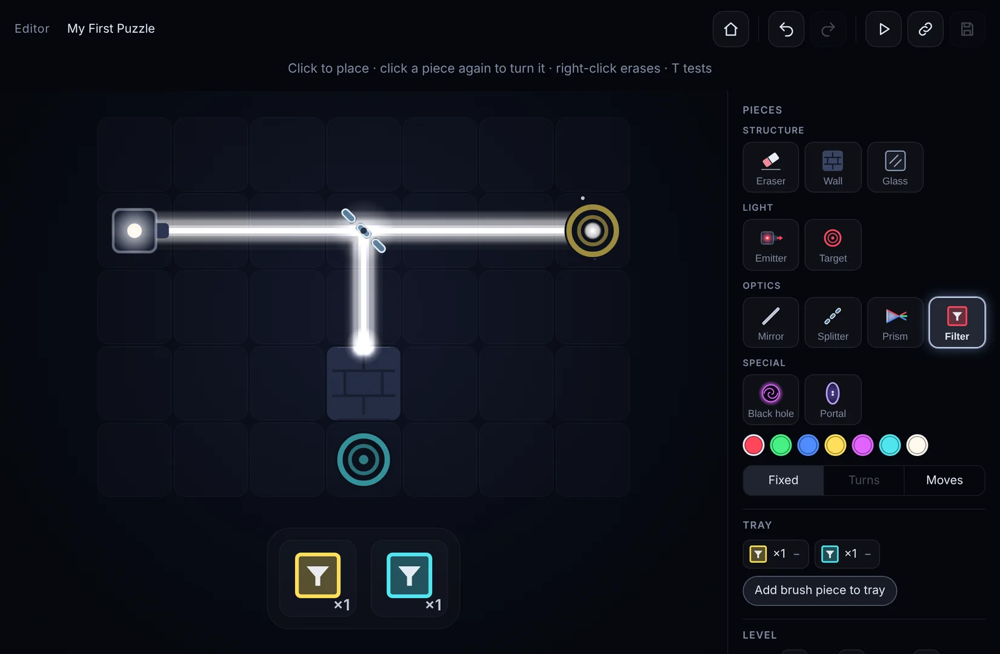
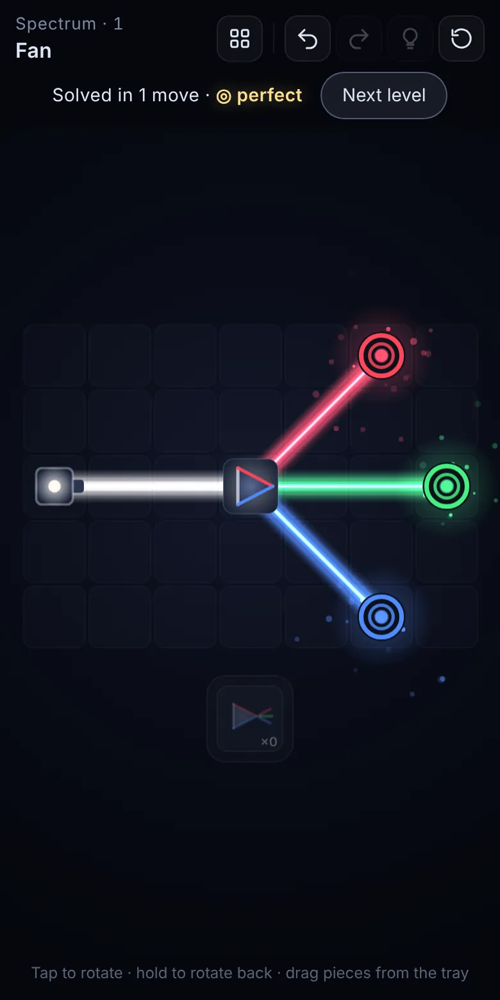

# Puzzle Light

A calm browser puzzle about light. Turn mirrors, split beams, filter and
fold them through portals until every ring receives exactly its colour.



**Play:** <https://nicolasfrechette91.github.io/puzzle-light/>, once GitHub
Pages is enabled (see [Deploying](#deploying)).

## The rules

* Emitters send coloured light in a straight line, in one of 8 directions.
* Light adds up: red + green = yellow, red + green + blue = white.
* A target is lit when the colours arriving at it add up to *exactly* its
  colour.
* Rings around pieces tell you what you may do. No ring: fixed. Dashed ring:
  turns, one dash per position. Tile underneath: movable. Pieces in the tray
  can be placed on any empty floor.
* Light can't slip between two walls that touch at a corner.

| piece | what it does |
|---|---|
| mirror | reflects (both faces) |
| splitter | reflects *and* lets light through |
| filter | keeps only its own colour |
| glass | lets light through; nothing can be built on it |
| black hole | swallows everything |
| prism | fans white into red, green and blue; tap to flip which side red goes |
| portal | light leaves its twin, still heading the same way |

51 levels in six worlds, plus five Expert bonus levels. Each world introduces
one idea and then remixes it:

| world | new idea | levels |
|---|---|---|
| Reflection | mirrors, right angles only | 9 |
| Division | 45° bends, splitters | 9 |
| Absorption | filters, glass, black holes | 8 |
| Spectrum | prisms | 8 |
| Wormholes | portals | 8 |
| Confluence | everything together | 9 |
| Expert | opens once every ✦ is earned | 5 |

Every level is checked by a solver to have exactly one solution; par
levels have exactly one fewest-piece solution. A world opens after you solve
6 levels of the previous one. If you get stuck, the hint button shows one next
step at a time.

<p>
  
  
  
  
</p>

## Controls

| action | mouse | touch | keyboard |
|---|---|---|---|
| turn a piece | click (right-click or wheel turns back) | tap (press and hold turns back) | arrows to move, Space (Shift+Space turns back) |
| place a piece | drag from the tray, or click a tray slot then a cell | drag, or tap slot then cell | 1–9 picks a slot, Space places |
| move / return a piece | drag it; drop off the board to return it | same | Backspace returns it |
| undo / redo / reset | toolbar | toolbar | `Z` / `Y` (or `Shift+Z`) / `R` |
| hint | lightbulb | lightbulb | `H` |
| levels | grid button | grid button | `L` |
| sound on/off | speaker | level select | `M` |

## Accessibility

Open the level select's **Options** row:

* **Colour symbols** marks every colour with a shape per channel, so mixes read
  as their parts: red ▲, green ■, blue ●, yellow ▲■, magenta ▲●, cyan ■●,
  white ▲■●.
* **Reduce motion** follows your system setting until you change it.

The whole game can be played by keyboard (arrows and Space on the board, Tab
through the controls), with a visible focus ring everywhere.

## Daily puzzle

Every day brings a new generated puzzle, the same for everyone (open the
**Daily** card in the level select, or go to `#daily`). Your moves, time and
streak are saved, and **Share result** copies a spoiler-free summary:

```
Puzzle Light · Daily #3
⬛⬛🟨🟨⬛🟨🟨🟨
🟩
9 moves (par 5) · 1:23 · 🔥3
```

## Endless mode

Pick **Easy**, **Medium** or **Hard** on the **Endless** card for a numbered
stream of generated puzzles at that difficulty (`#endless=hard`). Each one is
proven to have exactly one solution, and no Easy puzzle repeats an earlier
one. Skip any you don't fancy; you resume where you left off.

## Level editor

Open the editor with the pencil button, or go to `#edit`.

* Paint pieces, then choose what the player may do with each one (fixed,
  turns, moves) and fill the tray.
* The solver checks the level as you build. **Save** unlocks once a solution
  is verified, and each solution can be previewed on the board.
* **Test** to play it, **Share** to copy a `#play=…` link that opens the level
  for anyone.

<p>
  
  
</p>

## Develop

TypeScript, Vite and HTML5 Canvas, with no engine and no runtime
dependencies.

```bash
npm install
npm run dev        # http://localhost:5173  (?l=3 opens level 3)
npm test           # engine, solver (checked against brute force), editor, progress
npm run levels     # solve every level; fails on unsolvable or slow levels
npm run build      # typecheck + static build into dist/
```

```
src/core/     pure engine: board, beam tracing, solver, hints, share codes
src/game/     canvas renderer, input, HUD, sound, level select, progress
src/editor/   level editor (lazy-loaded) and its solver worker
src/levels/   the worlds (and the Expert bonus) as JSON
tests/        vitest suites and sample-level fixtures
scripts/      npm run levels
```

## Deploying

`.github/workflows/deploy.yml` tests, solves every level, builds and
publishes `dist/` to GitHub Pages on every push to `main`. It can also be run
by hand. To enable it, set **Settings → Pages → Build and deployment →
Source** to **GitHub Actions**. The build uses relative paths, so it works
from any sub-path.

`.github/workflows/ci.yml` runs the same checks on every push and pull
request.

## Docs

* [docs/DESIGN.md](docs/DESIGN.md): architecture, data model, level format,
  tracing, solver
* [docs/DECISIONS.md](docs/DECISIONS.md): decision policy and the log of every
  design decision
* [docs/ROADMAP.md](docs/ROADMAP.md): milestones and handoff notes

Everything is original: the art is drawn in code, and the sound is synthesised
in the browser.

## Licence

[MIT](LICENSE) © 2026 Nicolas Frechette
